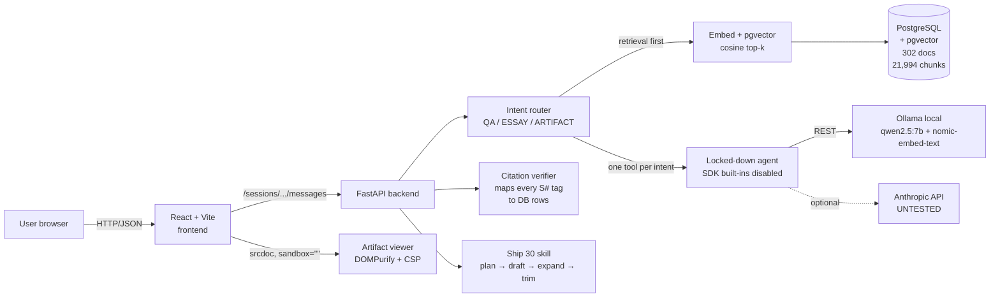

# Lenny Growth Assistant

A grounded Q&A and essay-drafting assistant for Lenny Rachitsky's podcast transcripts. The assistant answers from a corpus of 302 podcast episodes (21,994 vector chunks) with numbered-source citations and visible source passages, refuses out-of-scope questions without calling the model, and turns a grounded answer into a Ship-30-style essay or a one-pager artifact rendered in a sandboxed viewer. Local-first (Ollama + qwen2.5:7b) with an optional Anthropic cloud path.

Demo video: *(link added at submission)*

---

## 1. Architecture overview



Request flow (chat):

```mermaid
sequenceDiagram
    autonumber
    participant U as User
    participant FE as Frontend
    participant API as FastAPI
    participant RAG as pgvector
    participant LLM as Ollama/Anthropic
    participant V as Verifier
    U->>FE: types question
    FE->>API: POST /sessions/{id}/messages
    API->>API: classify intent (QA/ESSAY/ARTIFACT)
    API->>RAG: embed query + cosine top-k
    alt top_score < RETRIEVAL_MIN_SCORE
        API-->>FE: 200 exact refusal (0 LLM calls)
    else grounded follow-up (short + prior cited)
        API->>RAG: merge prior cited chunks (bypass score gate)
        API->>LLM: grounded prompt with [S1..Sn]
        LLM-->>API: answer with [S#] tags
        API->>V: validate every [S#] against DB
        V-->>API: cleaned_text + citations
        API-->>FE: 200 {content, citations, latency}
    else normal grounded QA
        API->>LLM: grounded prompt with [S1..Sn]
        LLM-->>API: answer with [S#] tags
        API->>V: validate tags; retry once if missing
        API-->>FE: 200 {content, citations, latency}
    end
```

1. Frontend POSTs the user message to `/sessions/{id}/messages`.
2. **Deterministic intent router** classifies QA / ESSAY / ARTIFACT and picks a tool menu (one tool per intent).
3. For QA, **retrieval runs in code first** (not as a tool call): embed query → pgvector cosine → top-k.
4. If `top_score < RETRIEVAL_MIN_SCORE`, the backend returns the exact refusal sentence **without calling the LLM**. Short/anaphoric follow-ups to a grounded answer bypass the score gate and merge the previous turn's cited chunks (R1 fix).
5. Otherwise the backend builds a numbered-sources prompt (`[S1]..[Sn]`), calls the locked-down agent runtime, verifies every `[S#]` tag against the retrieved set, and persists the message + citations.
6. ESSAY runs the Ship 30 skill (plan → draft → expand → repair → validate). ARTIFACT emits a deterministic HTML or Markdown document from the previous grounded answer (no new LLM call). Both open in the sandboxed viewer.

Key design decisions (see `SPEC.md §4` and `spike/SPIKE_LOG.md`):

- **D1 Retrieval runs in code**, not as a tool call. Spike: raw tool-calling skipped the tool 4/4 times on a specific topic.
- **D2 Tool-menu narrowing**: one tool per intent; the agent sees fewer tools and behaves predictably on a 7B model.
- **D3 Locked-down agent**: SDK built-in tools (Bash, Read, Write, Edit, WebFetch, ...) all disabled; `cwd` set to an empty temp dir. Spike: dropped prompt size from ~21.7k to 384 tokens.
- **D4 Grounding protocol**: `[S#]` tags validated server-side; citation list built from the database, never from model text.
- **D7 Artifacts are untrusted**: viewer iframe uses `sandbox=""` (no `allow-scripts`, no `allow-same-origin`), DOMPurify, inline CSP.
- **D8 Degraded mode**: on agent-runtime failure, fall back to a direct provider call with the same grounded prompt and set `degraded: true`.

Details: [docs/architecture.md](docs/architecture.md).

---

## 2. Prerequisites

| Requirement | Minimum | Notes |
|---|---|---|
| OS | Windows 10/11, macOS 12+, or Linux (x86-64) | — |
| Docker Desktop | 4.30+ (Linux: Docker Engine 24+ with Compose V2) | For db + backend + frontend. |
| Ollama | 0.3+ installed on the host | Must be running natively — the backend reaches it via `host.docker.internal:11434`. |
| RAM | 16 GB | qwen2.5:7b fits in ~5 GB at `num_ctx=4096`. |
| GPU (optional) | NVIDIA 6 GB VRAM+ | Dramatically faster essays; CPU-only works but is slow. |
| Git | 2.30+ | — |
| Free disk space | ~15 GB | ~5 GB model + ~2 GB Postgres volume + corpus. |

---

## 3. Installation and quick start

A single `make first-run` does fetch + build + wait-for-health + ingest. On Windows, use the PowerShell path.

### macOS / Linux

```bash
# 1. Clone and enter the repository
git clone https://github.com/Justinvcj/lenny-assistant.git
cd lenny-assistant

# 2. Create .env
cp .env.example .env

# 3. Pull the two Ollama models
ollama pull qwen2.5:7b
ollama pull nomic-embed-text

# 4. Set the Ollama context length (one time)
OLLAMA_CONTEXT_LENGTH=8192 ollama serve &

# 5. One-command bring-up: fetches transcripts, builds containers, waits for health, ingests
make first-run

# fetch_data.py is idempotent: if ./data/lennys-podcast-transcripts/episodes already
# exists it is left untouched. Pass --force to re-clone:
#   python scripts/fetch_data.py --force

# 6. Open the app and check health
curl http://localhost:8000/health
#   Frontend: http://localhost:3000
#   Backend API: http://localhost:8000
#   API docs: http://localhost:8000/docs
```

Expected `/health` payload once ingestion has run:

```json
{
  "status": "ok",
  "ingested": true,
  "database": {"connected": true, "vector_count": 21994, "ingested": true},
  "provider": {"name": "ollama", "model": "qwen2.5:7b", "ok": true, "status": "ok", "reason": null},
  "ollama": {"reachable": true, "llm_model_present": true, "embedding_model_present": true,
             "llm_model": "qwen2.5:7b", "embedding_model": "nomic-embed-text"}
}
```

### Windows (PowerShell)

```powershell
# 1. Clone and enter the repository
git clone https://github.com/Justinvcj/lenny-assistant.git
cd lenny-assistant

# 2. Create .env
Copy-Item .env.example .env

# 3. Pull the Ollama models
ollama pull qwen2.5:7b
ollama pull nomic-embed-text

# 4. Set context length and start Ollama (new terminal, kept open)
$env:OLLAMA_CONTEXT_LENGTH="8192"; ollama serve

# 5. First-run (helper script does fetch + build + ingest)
./scripts/first-run.ps1

# 6. Open http://localhost:3000
```

If `make` is not available on Windows, run the steps the Makefile runs:

```powershell
python scripts/fetch_data.py
docker compose up -d --build
# wait until /health returns {"status":"ok"} …
docker compose exec -T backend python -m scripts.ingest
```

**Git Bash on Windows note:** paths like `/app/tests` get mangled by MSYS. Prefix the command with `MSYS_NO_PATHCONV=1` when passing absolute container paths to `docker compose exec`.

---

## 4. Environment variables

Every variable in `.env.example`:

| Variable | Default | Required | Meaning |
|---|---|---|---|
| `LLM_PROVIDER` | `ollama` | Yes | `ollama` (local, tested) or `anthropic` (cloud, UNTESTED with a valid key). |
| `LLM_MODEL` | `qwen2.5:7b` | Yes | For Anthropic, set a current Claude model id (e.g. `claude-sonnet-4-20250514`). |
| `OLLAMA_BASE_URL` | `http://host.docker.internal:11434` | Yes (Ollama) | How the backend container reaches Ollama. See §6 Linux notes. |
| `EMBEDDING_MODEL` | `nomic-embed-text` | Yes | 768-dim embedding model; must be pulled in Ollama. |
| `EMBEDDING_DIM` | `768` | Yes | Verified at startup against a live embed call. |
| `ANTHROPIC_API_KEY` | *(empty)* | Only if `LLM_PROVIDER=anthropic` | Not required for local Ollama. |
| `DATABASE_URL` | `postgresql+psycopg://postgres:localdev@db:5432/lenny_assistant` | Yes | Throwaway local password. |
| `RETRIEVAL_TOP_K` | `5` | Yes | Max chunks returned per query. |
| `RETRIEVAL_MIN_SCORE` | `0.62` | Yes | Cosine floor for answering; below → refusal with zero LLM calls. |
| `HISTORY_TURNS` | `6` | Yes | Prior turns included in the prompt / rewrite. |
| `AGENT_TIMEOUT_S` | `120` | Yes | QA agent timeout. |
| `ARTIFACT_TIMEOUT_S` | `90` | Yes | Deterministic artifact (summary) timeout. |
| `ESSAY_TIMEOUT_S` | `420` | Yes | Ship 30 essay pipeline timeout. |
| `ARTIFACT_MAX_BYTES` | `200000` | Yes | Rejected with `artifact_too_large` above this. |
| `CORS_ORIGINS` | `http://localhost:5173,http://localhost:3000` | Yes | Comma-separated origins. |
| `DATA_DIR` | `/data` | Yes | Where the backend reads transcripts (mounted read-only). |
| `LOG_LEVEL` | `INFO` | No | Standard Python levels. |
| `BACKEND_PORT` | `8000` | No | Host-side port binding for the backend. |
| `FRONTEND_PORT` | `3000` | No | Host-side port binding for the frontend. |
| `VITE_API_BASE_URL` | `http://localhost:8000` | No | Built into the frontend at build time; must point at the exposed backend port. |

PostgreSQL is **not** published to the host by default; the backend reaches it inside the compose network.

---

## 5. Local model setup (Ollama)

Required models:

```bash
ollama pull qwen2.5:7b          # ~5 GB, chat model
ollama pull nomic-embed-text    # ~0.3 GB, 768-dim embeddings
```

Verify models are loaded on the GPU (if present):

```bash
ollama ps
# Expect to see qwen2.5:7b with GPU% > 0 while a chat is in flight.
```

How containers reach Ollama:

- **Docker Desktop (Windows, macOS):** `OLLAMA_BASE_URL=http://host.docker.internal:11434`. The compose file declares `extra_hosts: - "host.docker.internal:host-gateway"` so the backend container resolves it.
- **Linux without Docker Desktop:** the same `extra_hosts` entry is active and routes to the host gateway. If it fails, set `OLLAMA_HOST=0.0.0.0:11434` on the host before `ollama serve` so Ollama listens on all interfaces, and keep `OLLAMA_BASE_URL=http://host.docker.internal:11434` in `.env`. **UNVERIFIED on Linux** — only Docker Desktop (Windows) was exercised in this project.

Context length (one-time environment setting that affects every Ollama session):

```bash
OLLAMA_CONTEXT_LENGTH=8192 ollama serve
```

The default `num_ctx` of 4096 truncates the grounded prompt on long essay runs; 8192 keeps the full sources block.

---

## 6. Cloud model setup (Anthropic)

The `anthropic` provider path is **implemented and error-handled but NOT tested with a valid key**.

To switch:

```bash
# .env
LLM_PROVIDER=anthropic
LLM_MODEL=claude-sonnet-4-20250514   # or any current Claude model id
ANTHROPIC_API_KEY=sk-ant-...
```

Typed errors (never a silent switch to local):

- **Missing key**: `/health` reports `provider.ok=false, provider.reason="missing_api_key"`. Chat requests return `502 {"error":{"code":"bad_gateway","message":"Anthropic API key is not configured ..."}}`.
- **Invalid key**: `/health` reports `provider.ok=false, provider.reason="invalid_api_key"` after a 401 from the API. Chat requests return `502 {"error":{"code":"llm_unavailable", ...}}`.
- **Transport failure**: wrapped the same way.

See `backend/app/llm/anthropic_provider.py`.

---

## 7. Run commands

| Command | What it prints / does |
|---|---|
| `make first-run` | Fetches data, `docker compose up -d --build`, polls `/health`, runs ingestion. Prints "First-run setup complete!" and the three URLs. |
| `make up` | `docker compose up -d`. Starts all services detached. |
| `make down` | `docker compose down`. Stops containers (volumes preserved). |
| `make fetch-data` | Runs `scripts/fetch_data.py` which clones the transcripts repo into `./data/`. |
| `make ingest` | `docker compose exec -T backend python -m scripts.ingest`. Parses → chunks → embeds → stores (content-hash idempotent). |
| `docker compose exec -T backend python -m scripts.ingest --reset` | Clears existing docs/chunks before re-ingesting. |
| `docker compose logs -f backend` | Tails backend logs (structured JSON). |
| `curl http://localhost:8000/health` | Prints `{"status":"ok", "database":..., "provider":..., "ollama":...}`. |
| `make test-backend` | `docker compose exec -T backend pytest`. |
| `make test-frontend` | `cd frontend && npm test`. |

Verified cheaply with `make -n first-run` and `docker compose config`.

---

## 8. How it works

- **Ingestion & chunking** (`backend/app/rag/ingest.py`, `chunking.py`): parses the transcript markdown, splits into overlapping chunks around speaker boundaries, embeds each chunk with Ollama's `nomic-embed-text`, stores in pgvector. Content-hash idempotent.
- **Retrieval & citations** (`backend/app/rag/retrieval.py`, `agent/verify.py`): cosine similarity, top-k, threshold gate. Citation list is built from the database rows the model's `[S#]` tags resolve to — not from model text.
- **Agent routing & tool narrowing** (`backend/app/agent/router.py`, `tools.py`, `orchestrator.py`): deterministic rule-based router picks QA / ESSAY / ARTIFACT and the one tool for that intent. All built-in SDK tools disabled.
- **Ship 30 skill** (`backend/app/skills/ship30.py`, `validator.py`, `ship30_rules.yaml`): plan outline → draft each section → up to 2 expansion passes (unused sources only) → repair pass → trim pass. Canonical body length 1,100–1,400 words; `review_floor` 1,000; `trim_target` 1,350. Validator enforces length, hook, structure, specific headings, section budgets, no-duplicate paragraphs, `[S#]`-only citations, formatting, takeaway, citation coverage, and groundedness (sentence support, verbatim quotes, speaker names).
- **Artifact generation** (`backend/app/routers/chat.py` → `generate_deterministic_html_summary` / `_markdown_summary`): no LLM call — converts the prior grounded answer to a tokenized Markdown → HTML pipeline, inlines citation `<sup><a>` anchors, lists sources with passages, inline CSS. Viewer renders in an iframe with `sandbox=""` (no scripts, no same-origin), DOMPurify-sanitized, inline CSP in the srcdoc.
- **Fallback behaviour** (`SPEC.md §4 D8`, `docs/architecture.md §10`):
  - Agent runtime timeout → direct provider call with the same grounded prompt, response flagged `degraded: true`.
  - Ollama unreachable → `/health` reports `degraded`, chat requests return `502 llm_unavailable`.
  - Postgres down → `/health` reports `degraded, database_down`, mutating requests return `503 db_unavailable`.
  - Anthropic key missing/invalid → `502 bad_gateway` or `502 llm_unavailable`.
  - Retrieval empty / below threshold → the exact refusal sentence, zero LLM calls, logged with `action: refusal_below_retrieval_threshold`.
  - **Never a silent switch from local to cloud**: the configured provider is used until the user changes `LLM_PROVIDER`.

More: [docs/architecture.md](docs/architecture.md), [docs/security.md](docs/security.md).

---

## 9. Tests

Backend (510 tests at the last full run, 0 failures, 0 skipped):

```bash
# All backend tests
docker compose exec -T backend pytest

# Only tests that don't need Ollama (skips the live follow-up audit)
docker compose exec -T backend pytest --ignore=tests/test_followup_audit.py --ignore=tests/test_sdk_live.py
```

Coverage: chat router, retrieval, chunking, parsers, agent orchestrator, intent router, Ship 30 skill (planning, drafting, expansion, repair, validator rules), citation verifier, artifact routes, LLM providers (ollama + anthropic), health probes, error envelopes, DB persistence.

Frontend (235 tests at the last full run, 0 failures):

```bash
cd frontend && npm test
# or:
cd frontend && npx vitest run
```

Coverage: artifact sanitization, iframe rendering, session persistence/switching, chat composer, model badge, loading/error states, API retry.

Manual UI test plan: [docs/TEST_PLAN.md](docs/TEST_PLAN.md).

Evaluation scripts (not run on every build; require ingestion + Ollama up):

- `backend/scripts/eval_e2e.py`
- `backend/scripts/evaluate_retrieval.py`
- `backend/scripts/evaluate_retrieval_threshold.py`
- `backend/scripts/corpus_stats.py`

---

## 10. Troubleshooting

| Symptom | Cause | Fix |
|---|---|---|
| `/health` shows `provider.ok=false, reason="ollama_unreachable"` | Ollama not running on the host, or `host.docker.internal` doesn't resolve. | `ollama serve` on the host; on Linux ensure the `extra_hosts: host.docker.internal:host-gateway` entry resolves (otherwise set `OLLAMA_HOST=0.0.0.0`). |
| `/health` shows `llm_model_present=false` | Model not pulled. | `ollama pull qwen2.5:7b && ollama pull nomic-embed-text`. |
| Essays taking 3–5 min with GPU idle | Model spilled to CPU. | `ollama ps` to confirm; close other GPU apps or raise `OLLAMA_CONTEXT_LENGTH` and `num_gpu`. |
| `Error starting userland proxy ... bind: address already in use` | Port 8000 or 3000 is taken. | Change `BACKEND_PORT` / `FRONTEND_PORT` in `.env` (and `VITE_API_BASE_URL`), then rebuild. |
| Chat always refuses, retrieval scores near 0 | Ingestion hasn't run. | `make ingest`; then verify `/health` shows `vector_count > 0`. |
| Backend fails to start with CRLF errors on `entrypoint.sh` | Windows CRLF line endings committed into a shell script. | `.gitattributes` enforces LF for `*.sh`; re-clone or `git add --renormalize .`. |
| `docker compose exec /app/tests ... No such file or directory` | Git Bash converted the absolute container path. | Prefix with `MSYS_NO_PATHCONV=1`. |
| Frontend shows "Network error" | `VITE_API_BASE_URL` points at the wrong port, or `BACKEND_PORT` changed after frontend build. | Rebuild the frontend after changing `.env` (`docker compose up -d --build frontend`). |
| `503 db_unavailable` on every request | Postgres container not yet healthy. | Wait a few seconds, or `docker compose logs db`; `make first-run` already waits. |
| Essays below the 1,100-word floor marked "Needs review" | Model drafted below floor and 2 expansion passes found no unused supported passages. | Expected behavior; see Known limitations. |
| First essay or first chat is noticeably slower than later ones (~15 s extra) | Ollama loads the model and the embedding model lazily on the first call. | Expected on cold start; warm the model with `curl -s http://localhost:11434/api/generate -d '{"model":"qwen2.5:7b","prompt":"hi"}' > /dev/null` after `ollama serve`. |
| First embed call returns `connection reset` once, then succeeds | Ollama's embedding worker starts on demand and the first socket can race. | The ingestion script retries; a single failure during warm-up is safe to ignore. |
| Backend container exits with Alembic `ProgrammingError: relation ... does not exist` | Alembic migrations did not run on first startup (rare; entrypoint.sh is responsible). | `docker compose exec -T backend alembic upgrade head` then restart the backend. |
| `/health` reports `vector_count=0` but ingestion seems to have finished | Ingestion was pointed at an empty `./data/` or a different `DATA_DIR`. | Confirm `./data/lennys-podcast-transcripts/episodes/` has files; re-run `make fetch-data && make ingest`. |

---

## 11. Project structure

```
.
├── README.md                 # This file
├── SPEC.md                   # Source-of-truth design decisions
├── CLAUDE.md / AGENTS.md     # Session rules for the authoring assistants
├── Makefile                  # first-run / up / down / ingest / tests
├── docker-compose.yml        # db (pgvector), backend, frontend, optional ollama profile
├── .env.example              # All environment variables
├── backend/                  # FastAPI + SQLAlchemy + Alembic + Ship 30 skill
│   ├── app/
│   │   ├── routers/          # chat, sessions, artifacts, health, client_events
│   │   ├── agent/            # orchestrator, prompts, tools, router, verify
│   │   ├── rag/              # ingest, chunking, embeddings, retrieval, parser
│   │   ├── skills/           # ship30.py, validator.py, ship30_rules.yaml
│   │   └── llm/              # ollama_provider, anthropic_provider, factory
│   ├── scripts/              # ingest, evaluators, corpus stats
│   └── tests/                # 510 pytest cases
├── frontend/                 # React + Vite + TypeScript + vitest (235 tests)
├── docs/                     # PRD, architecture, design, security, TEST_PLAN, FIX_LOG
├── scripts/                  # fetch_data.py, first-run.ps1, eval helpers
├── spike/                    # Measured discovery evidence (SPIKE_LOG.md)
└── transcripts/              # Agent transcripts (process/ holds the implementation playbook)
```

Docs index:

| File | What it covers |
|---|---|
| [`docs/PRD.md`](docs/PRD.md) | User, metrics, assumptions, risks, scope, acceptance table, Known limitations. |
| [`docs/architecture.md`](docs/architecture.md) | System overview, request flow, data model, API, fallback matrix. |
| [`docs/design.md`](docs/design.md) | UI/UX design decisions. |
| [`docs/security.md`](docs/security.md) | Threat model, iframe sandbox, prompt injection, secrets. |
| [`docs/TEST_PLAN.md`](docs/TEST_PLAN.md) | Manual UI test plan. |
| [`docs/FIX_LOG.md`](docs/FIX_LOG.md) | Chronological audit + fix log. |
| [`docs/AUDIT_FINAL.md`](docs/AUDIT_FINAL.md) | Independent audit report. |
| [`transcripts/process/`](transcripts/process/) | Candidate implementation playbook (START_HERE, WORK_SPLIT, PROMPTS). |

---

## 12. Known limitations and technical debt

Taken from [docs/PRD.md §9](docs/PRD.md).

- **Essay heading quality**: when a drafted body section's first sentence has no `[S#]` tag, `derive_heading_from_section` returns empty and the plan's placeholder "Angle N on …" title persists. Validator's `R_SPECIFIC_HEADINGS` flags it but no runtime remediation retries derivation. Both RUN3 live essays failed this rule.
- **Essay support score below target**: Flow 2 (PLG + Elena Verna) 12.5%, Flow 3 (pricing) 18.5% versus a 70% target. Sentences carry correct `[S#]` tags but the sentence-level overlap check marks most as paraphrased.
- **Short follow-ups partially met**: ~2 of 6 live Q2 "Why is that?" turns refuse after passing the score-gate bypass because the model/verifier chooses to refuse. Allowed by spec but visible as a refusal.
- **File sizes not split**: `backend/app/routers/chat.py` (~1,250 lines) and `backend/app/agent/verify.py` (~720 lines) grew during the fix passes and were intentionally not refactored to avoid late regressions. `SPEC.md §6` lists this as an accepted cohesion exception.
- **Anthropic provider UNTESTED with a valid key**: implemented, surfaces typed health errors and wraps API failures as 502, but no run with a real key was performed.
- **Trim path not re-exercised live**: `trim_essay_sections` has unit coverage but was not triggered live (no essay exceeded 1,400 words in RUN3).

---

## 13. Data notice

The podcast transcripts come from <https://github.com/ChatPRD/lennys-podcast-transcripts>. The upstream repository states they are **"provided for personal and educational use"** by their original authors; it is the authoritative source for permitted use and attribution. **This repository does not redistribute the transcripts**: `./data/` is gitignored, nothing under `data/` is tracked (verified with `git ls-files .env data notes` empty), and `scripts/fetch_data.py` clones the upstream repo into `./data/lennys-podcast-transcripts/` on first run. Please review the upstream repository's README and attribution before using the data for anything beyond personal evaluation of this project.
