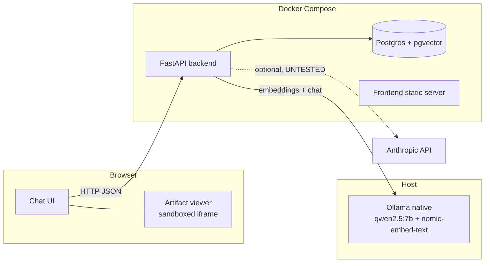
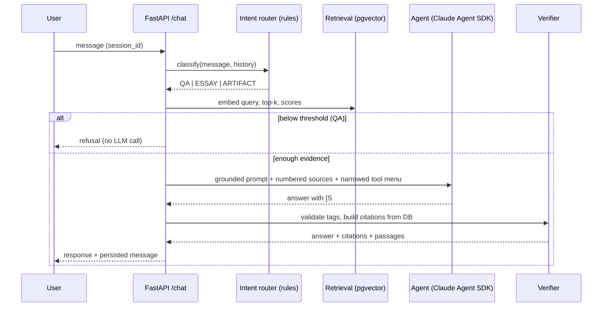

# Architecture — Lenny Growth Assistant

Status: design baseline (v0.1). Update to match code before submission (playbook P12).

## 1. System overview

Ollama runs on the host for GPU access. The backend container reaches it via `host.docker.internal`. A containerized Ollama option is documented in the README but not the default.

## 2. Request flow (chat)


## 3. Intent router and tool menus (deterministic, D1/D2)
| Intent | Trigger (rules, case-insensitive) | Retrieval | Tools visible to agent |
|---|---|---|---|
| ESSAY | "essay", "ship 30", "ship30", "turn that into", "write an article/post" | yes (reuse last answer's sources + fresh query) | `generate_ship30_essay` |
| ARTIFACT | "html", "one-pager", "landing page", "markdown doc", "make a page/document" | optional (reuse last sources) | `create_artifact` |
| QA (default) | anything else | **always** | `search_transcripts` (for a second refinement search only) |

Rules live in `agent/router.py`, are unit-tested, and can be extended without touching the agent. If the agent does not call the expected tool for ESSAY/ARTIFACT, code calls the skill directly (deterministic fallback).

## 4. Agent runtime rules (D3)
- `allowed_tools` = our MCP tools only; every built-in SDK tool disabled; permission mode default.
- `cwd` = empty temp directory (prevents project CLAUDE.md/AGENTS.md leaking into the model prompt; verify via logged `input_tokens`).
- `max_turns` small (4–6), hard timeout `AGENT_TIMEOUT_S`.
- Log `input_tokens`, tool calls, turns for every request.
- Provider switch: for `ollama` set `ANTHROPIC_BASE_URL=<OLLAMA_BASE_URL>`, `ANTHROPIC_AUTH_TOKEN=ollama` (dummy); for `anthropic` use the real key and default base URL.
- Backend image installs Node 20 + `@anthropic-ai/claude-code` (SDK dependency).

## 5. RAG pipeline
**Ingestion** (`scripts/ingest.py`, idempotent):
1. Download/clone transcripts into `DATA_DIR` (not committed).
2. Parse each file: title, guest, date/slug, speaker turns (see `docs/DATA_NOTES.md` for real format).
3. Chunk: speaker-turn aware, ~350–450 tokens, 1-turn overlap, never split mid-sentence; store char offsets and speaker.
4. Embed via Ollama `/api/embed` in batches with `search_document: ` prefix (Nomic task prefix; verify benefit on eval).
5. Upsert documents and chunks keyed by content hash; unchanged files are skipped, changed files re-chunked, new files added (this is the "refresh" story).
6. Create HNSW cosine index.

**Retrieval** (`rag/retrieval.py`): embed query with `search_query: ` prefix; cosine top-k; return chunk text, score, document title, guest, slug, offsets. Follow-ups: rewrite query using the last user question when the message is short or pronoun-heavy. Threshold `RETRIEVAL_MIN_SCORE` tuned on the eval set. Stretch: hybrid with Postgres full-text via reciprocal rank fusion.

**Citations:** each prompt source gets a number `[S#]`. Model tags claims with `[S#]`. `agent/verify.py` extracts tags, drops/flags invalid ones, builds the citation list from DB rows (episode title, guest, passage excerpt). Answers with zero valid tags are retried once, then converted to refusal.

## 6. Data model (PostgreSQL)
```sql
CREATE EXTENSION IF NOT EXISTS vector;

CREATE TABLE documents (
  id            UUID PRIMARY KEY,
  slug          TEXT UNIQUE NOT NULL,
  title         TEXT NOT NULL,
  guest         TEXT,
  published_at  DATE,
  source_path   TEXT NOT NULL,
  content_hash  TEXT NOT NULL,
  metadata      JSONB NOT NULL DEFAULT '{}',
  created_at    TIMESTAMPTZ NOT NULL DEFAULT now(),
  updated_at    TIMESTAMPTZ NOT NULL DEFAULT now()
);

CREATE TABLE chunks (
  id            UUID PRIMARY KEY,
  document_id   UUID NOT NULL REFERENCES documents(id) ON DELETE CASCADE,
  chunk_index   INT  NOT NULL,
  text          TEXT NOT NULL,
  token_count   INT,
  speaker       TEXT,
  start_char    INT,
  end_char      INT,
  embedding     VECTOR(768) NOT NULL,   -- dim verified at startup
  UNIQUE (document_id, chunk_index)
);
CREATE INDEX chunks_embedding_hnsw ON chunks USING hnsw (embedding vector_cosine_ops);

CREATE TABLE sessions (
  id            UUID PRIMARY KEY,
  title         TEXT,
  client_id     TEXT,
  user_metadata JSONB NOT NULL DEFAULT '{}',
  llm_provider  TEXT NOT NULL,
  llm_model     TEXT NOT NULL,
  created_at    TIMESTAMPTZ NOT NULL DEFAULT now(),
  updated_at    TIMESTAMPTZ NOT NULL DEFAULT now()
);

CREATE TABLE messages (
  id            UUID PRIMARY KEY,
  session_id    UUID NOT NULL REFERENCES sessions(id) ON DELETE CASCADE,
  role          TEXT NOT NULL CHECK (role IN ('user','assistant')),
  content       TEXT NOT NULL,
  intent        TEXT,
  citations     JSONB NOT NULL DEFAULT '[]',   -- [{n, chunk_id, doc_slug, title, guest, passage}]
  tool_trace    JSONB NOT NULL DEFAULT '[]',   -- tool names, durations, input_tokens
  degraded      BOOLEAN NOT NULL DEFAULT FALSE,
  latency_ms    INT,
  created_at    TIMESTAMPTZ NOT NULL DEFAULT now()
);
CREATE INDEX messages_session_idx ON messages(session_id, created_at);

CREATE TABLE artifacts (
  id            UUID PRIMARY KEY,
  session_id    UUID NOT NULL REFERENCES sessions(id) ON DELETE CASCADE,
  message_id    UUID REFERENCES messages(id) ON DELETE SET NULL,
  type          TEXT NOT NULL CHECK (type IN ('markdown','html')),
  title         TEXT NOT NULL,
  content       TEXT NOT NULL,
  created_at    TIMESTAMPTZ NOT NULL DEFAULT now()
);
```
Schema is managed by Alembic (`001_initial_schema`, `002_add_user_metadata`).

## 7. API
| Method & path | Purpose | Success | Errors |
|---|---|---|---|
| GET /health | db, ollama, embedding model, vector count, ingested flag | 200 (status ok/degraded) | 503 when DB down |
| GET /config | active provider/model, embedding model | 200 | — |
| POST /sessions | create session (accepts optional client_id & user_metadata; captures User-Agent & Accept-Language; no IP stored) | 201 | 422 |
| GET /sessions | list sessions (newest first) | 200 | — |
| GET /sessions/{id} | session + messages + user_metadata | 200 | 404 |
| DELETE /sessions/{id} | delete session (cascades to messages & artifacts) | 204 | 404 |
| POST /sessions/{id}/messages | send message, run pipeline | 200 `{message, citations, artifact?, intent, degraded, latency_ms}` | 404, 422, 502 (LLM unavailable), 504 (timeout) |
| GET /artifacts/{id} | fetch artifact | 200 | 404 |
| POST /artifacts | create artifact directly with type and size checks | 201 | 413, 422 |
| POST /client-events | ingest frontend diagnostic telemetry (render/sanitize errors, size rejection; never content) | 204 | 422 |
All bodies validated by Pydantic; message length capped; errors use the standard envelope.

## 8. LLM provider abstraction
`llm/base.py` defines `LLMProvider` (chat, embed, health). `factory.py` returns provider from config. The agent runtime obtains its SDK environment from the same factory. Adding a provider = one class + one factory branch. Anthropic provider is implemented and unit tested with mocked HTTP transport.

## 9. Ship 30 skill
`skills/ship30_rules.yaml` holds the encoded principles (hook, structure, formatting, length, takeaway, citation rule), sourced from the assignment's linked reference. `skills/ship30.py` runs: retrieve → outline → draft section by section with word budgets (a 7B model cannot hit 1,250 words in one pass) → assemble → validate (length range, hook present, headings, takeaway, every claim section has `[S#]`) → one repair pass → persist as markdown artifact. Validator is pure code and unit-tested.

## 10. Fallback Behaviour & Failure Modes

### Strict No-Silent-Switch Guarantee
The system **never silently switches** from Ollama to a cloud provider (or vice-versa). The active provider is determined exclusively by explicit configuration (`LLM_PROVIDER`). A failure of the local model will never incur unexpected cloud API charges or send user prompts to an unconfigured third-party service.

### Degradation Matrix
| Failure Condition | Immediate Behaviour | Fallback Mechanism | Telemetry & Observability |
|---|---|---|---|
| **Agent runtime failure or timeout** | Agent SDK / tool call raises or times out (`AGENT_TIMEOUT_S`) | **Degraded direct call to the SAME provider**: The backend immediately invokes a single-shot direct completion to the identical configured model (`qwen2.5:7b` or `claude-3-5-sonnet`) with grounded context. Response has `degraded: true`. | Logged with `degraded: true` and warning log. |
| **Ollama unreachable** | Connection refused or network timeout connecting to `OLLAMA_BASE_URL` | Request returns `502 Bad Gateway` (`llm_unavailable`). `/health` returns HTTP 200 `status: "degraded"`. UI surfaces clear banner. | Structured log: `Ollama is unreachable at {base_url}`. |
| **Missing or invalid cloud key** | `LLM_PROVIDER=anthropic` with empty or invalid `ANTHROPIC_API_KEY` | Immediate failure at startup or request dispatch with `401 Unauthorized` / `invalid_api_key`. Request aborted; no silent fallback. | Structured log with `invalid_api_key` error code. |
| **Empty or weak retrieval** | All chunks below calibrated `RETRIEVAL_MIN_SCORE` (0.62) or knowledge base empty | Canonical grounded refusal returned: *"I could not find relevant information in Lenny's Podcast transcripts to answer your question."* **Zero LLM tokens consumed**. | `top_score` logged in request context; refusal event tracked. |
| **Empty Knowledge Base** | Ingestion pipeline has not been executed (`chunks` count is 0) | `/health` reports `ingested: false`. Frontend renders an informational banner prompting user to run `make ingest`. Search returns empty results without crashing. | `/health` reports `ingested: false`. |
| **Artifact rendering or sanitization failure** | DOMPurify throws, unexpected HTML structure, or React rendering error | `<ArtifactErrorBoundary>` catches failure; renders friendly fallback notice in panel. Source view and download remain available. | Frontend POSTs small event (`type`, `artifact_id`, `reason`) to `/client-events`; logged as structured JSON line. |
| **Oversized artifact** | Artifact content exceeds 200,000 bytes security limit | UI renders friendly warning and disables live preview. Backend rejects with HTTP 413 `artifact_too_large`. | Frontend POSTs `artifact_size_rejected` event to `/client-events`. |

## 11. Observability
JSON logs with `request_id, session_id, intent, provider, model, retrieval_ms, llm_ms, total_ms, n_chunks, top_score, input_tokens, degraded, error_code`. A request id is returned in the `X-Request-ID` header.

## 12. Deployment topology
`docker-compose.yml`: `db` (pgvector/pgvector:pg16, volume `pgdata`, healthcheck), `backend` (depends on healthy db; Node + Claude Code CLI installed; runs migrations then Uvicorn), `frontend` (built static assets served on :3000 or Vite dev on :5173). Ollama on host by default; optional `ollama` Compose profile with GPU notes. Evaluator flow: `cp .env.example .env` → `ollama pull qwen2.5:7b nomic-embed-text` → `docker compose up --build` → `docker compose exec backend python -m scripts.ingest`.

## 13. Security
See `docs/security.md` (artifact sandbox, prompt injection, agent lockdown, secrets, data/IP).

## 14. Known limitations
Small-model faithfulness errors (measured); latency on weak hardware; anthropic path untested; no auth; retrieval quality at full-archive scale unmeasured.
